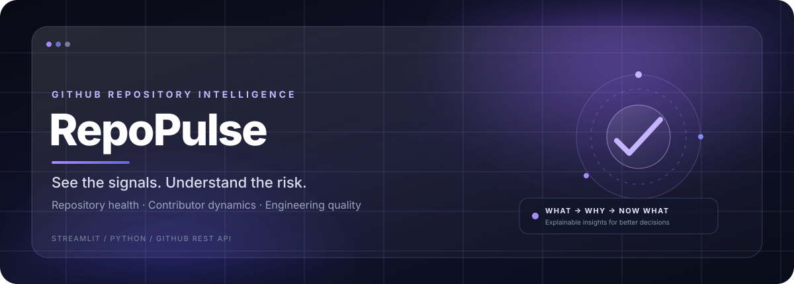

<div align="center">



<br>

[](https://python.org)
[](https://streamlit.io)
[](https://docs.github.com/en/rest)
[](https://docs.pytest.org/)

**Turn repository activity into engineering clarity.**

RepoPulse transforms GitHub repository data into explainable signals about project health, contributor activity, engineering maturity, and risk.

[Explore features](#-repository-intelligence) · [Quick start](#-quick-start) · [Configuration](#-configuration) · [Report an issue](https://github.com/arjunajithan04/repopulse/issues)

</div>

---

## ◈ What is RepoPulse?

RepoPulse is a Streamlit-based GitHub repository intelligence dashboard. It brings repository telemetry and engineering signals into one workspace, helping you understand not just *what is happening* in a repository, but *why it matters* and *what to do next*.

<div align="center">

| <sub>01 / OBSERVE</sub><br>**Repository pulse** | <sub>02 / UNDERSTAND</sub><br>**Explainable signals** | <sub>03 / ACT</sub><br>**Prioritized next steps** |
|:---:|:---:|:---:|
| Health, activity, and community metrics | Risk factors and engineering context | Assessments, comparisons, and recommendations |

</div>

## ◈ Repository intelligence

The workspace follows a simple narrative: **WHAT → WHY → SO WHAT → NOW WHAT**.

<table>
<tr>
<td width="50%" valign="top">

### ◉ Executive Dashboard
- Key repository metrics at a glance
- Adaptive highlights and activity trends
- Engineering pulse and health signals

</td>
<td width="50%" valign="top">

### ⌘ Repository Analysis
- Analyze public repositories by URL or `owner/repo`
- Repository metadata, activity, issues, and pull requests
- Deep code scan and historical snapshots

</td>
</tr>
<tr>
<td width="50%" valign="top">

### ◎ Contributor Intelligence
- Contributor activity and contribution patterns
- Team participation and momentum
- Leaderboards and concentration signals

</td>
<td width="50%" valign="top">

### ⌁ Code Insights
- Language composition
- File inventory and complexity signals
- Code-quality indicators and recommendations

</td>
</tr>
<tr>
<td width="50%" valign="top">

### ◈ Risk Center & Assessment
- Critical, high, and medium risk signals
- Executive assessment, strengths, and priorities
- Explainable evidence tied to repository metrics

</td>
<td width="50%" valign="top">

### ⇄ Compare & Predictive Risk
- Compare repository profiles and health dimensions
- Inspect trends and activity momentum
- Review predictive signals when sufficient history exists

</td>
</tr>
</table>

### More intelligence, not just more charts

- **What Changed** — compares the latest scan with a previous session snapshot.
- **Trend Intelligence** — retains historical health, development, and community signals.
- **Engineering intelligence** — checks documentation, testing structure, and common dependency manifests.
- **Live API telemetry** — surfaces GitHub API rate-limit information.
- **Refresh-aware caching** — repository data is cached briefly, with a live-refresh path to invalidate cached inputs.

> **Interpretation note:** Risk and assessment insights are rule-based and explainable, not generated by an external LLM. Code-quality indicators are bounded and may use heuristics when language-specific AST analysis is unavailable. Dependency-manifest inspection does **not** claim to detect vulnerabilities.

---

## ◈ Interface language

RepoPulse uses a dark, purple-and-indigo visual system with glass-inspired panels, restrained glow, clear metric hierarchy, and responsive layouts.

- **Glass-inspired surfaces** — translucent-looking cards and layered gradients.
- **Focused metrics** — visual emphasis on the numbers that matter.
- **Consistent navigation** — dedicated pages for each stage of repository analysis.
- **Context before conclusions** — raw operational counts are distinguished from normalized health dimensions.

<sub>GitHub renders README content in a restricted Markdown/HTML environment. The hero below is a static SVG; interactive application effects are experienced inside RepoPulse itself.</sub>

---

## ◈ Tech stack

| Layer | Technology |
|---|---|
| Application UI | Streamlit |
| Language | Python 3.12+ |
| Repository data | GitHub REST API v3 |
| Data processing | Pandas |
| HTTP requests | Requests |
| Visualizations | Plotly, with Streamlit chart fallbacks |
| Testing | pytest |
| Configuration | Environment variables / `.env` |

---

## ◈ Quick start

### 1. Clone the repository

```bash
git clone https://github.com/arjunajithan04/repopulse.git
cd repopulse
```

### 2. Create and activate a virtual environment

**Windows (PowerShell)**

```powershell
python -m venv .venv
.venv\Scripts\Activate.ps1
```

**macOS / Linux**

```bash
python -m venv .venv
source .venv/bin/activate
```

### 3. Install dependencies

```bash
python -m pip install --upgrade pip
pip install -r requirements.txt
```

### 4. Configure GitHub access

Create a `.env` file in the project root using `.env.example` as a reference:

```env
GITHUB_TOKEN=your_github_token_here
GITHUB_API_BASE_URL=https://api.github.com
APP_TITLE=RepoPulse
```

A token is recommended for higher GitHub API rate limits. Keep it private: **never commit `.env` or paste your token into source code**.

### 5. Launch RepoPulse

```bash
streamlit run app.py
```

Open the local URL printed by Streamlit, typically `http://localhost:8501`.

---

## ◈ How to use it

1. **Analyze a repository** — provide a public GitHub URL or `owner/repo`.
2. **Read the dashboard** — review health, activity, and engineering pulse.
3. **Investigate contributors** — inspect contribution patterns and team signals.
4. **Inspect code insights** — explore languages, file metrics, and complexity indicators.
5. **Assess risk** — review the evidence and recommended priorities.
6. **Compare and track** — compare repository profiles and use available historical snapshots.

Some code-level and predictive insights depend on a successful deep scan or sufficient historical data.

---

## ◈ Metrics at a glance

| Signal | What it helps you understand |
|---|---|
| Stars & forks | Adoption and community interest |
| Open issues & pull requests | Outstanding work and active collaboration |
| Repository health | A normalized view of repository vitality |
| Contributors | Breadth of participation |
| Languages | Reported language composition |
| Commit activity | Development cadence and momentum |
| Engineering signals | Documentation, testing, and dependency-manifest presence |
| Code complexity | Bounded indicators for files included in the scan |

**Compare like with like:** raw counts provide operational context, while normalized 0–100 dimensions are intended for more direct comparison.

---

## ◈ Project structure

```text
repopulse/
├── app.py
├── analysis/
│   ├── repository_analysis.py
│   ├── metrics.py
│   └── code_analysis.py
├── components/
│   ├── boot.py
│   ├── cards.py
│   ├── charts.py
│   ├── tables.py
│   └── ui.py
├── config/
│   └── settings.py
├── core/
│   ├── github_client.py
│   ├── models.py
│   └── repository.py
├── data/
│   └── history.py
├── pages/
│   ├── dashboard.py
│   ├── repository.py
│   ├── contributors.py
│   ├── code_insights.py
│   ├── risk_center.py
│   ├── assessment.py
│   ├── compare.py
│   └── predictive.py
├── tests/
├── assets/
├── requirements.txt
└── .env.example
```

*The tree highlights the main application areas; individual filenames may evolve as the project changes.*

---

## ◈ Testing

Run the project tests from the repository root:

```bash
pytest -q
```

Or run the analysis tests specifically:

```bash
pytest tests/test_analysis.py -v
```

Tests cover repository input parsing and analysis logic. The complete test suite should be run in an environment with all dependencies installed.

---

## ◈ Configuration & performance

- Repository metadata, contributors, pull requests, issues, languages, commits, repository trees, and individual file contents use a **5-minute Streamlit cache**.
- **Refresh live data** invalidates cached inputs for the selected repository while preserving historical snapshots.
- Historical data is stored locally by the application. Do not include private tokens or sensitive repository information in public issue reports.

### Environment variables

| Variable | Purpose |
|---|---|
| `GITHUB_TOKEN` | Optional GitHub token for API access and higher rate limits |
| `GITHUB_API_BASE_URL` | GitHub API base URL; defaults to `https://api.github.com` in the example configuration |
| `APP_TITLE` | Application title |

For a token, visit [GitHub personal access token settings](https://github.com/settings/tokens) and follow GitHub's current guidance for the repositories and access you need.

---

## ◈ Contributing

Contributions, bug reports, and thoughtful feature suggestions are welcome.

1. Open an issue describing the bug or proposal.
2. Keep changes focused and explain the reason for the change.
3. Run relevant tests before submitting a pull request.
4. Include screenshots for meaningful UI changes where possible.

[Open an issue](https://github.com/arjunajithan04/repopulse/issues) · [View the repository](https://github.com/arjunajithan04/repopulse)

## ◈ License

This project is licensed under the MIT License. See the `LICENSE` file for the complete terms.

---

<div align="center">

### Built for clearer repository decisions.

**Made with ❤️ by Arjun Ajithan**

[⭐ Star RepoPulse](https://github.com/arjunajithan04/repopulse) · [Report a bug](https://github.com/arjunajithan04/repopulse/issues)

<sub>Repository intelligence • Explainable risk • Engineering signals</sub>

</div>
